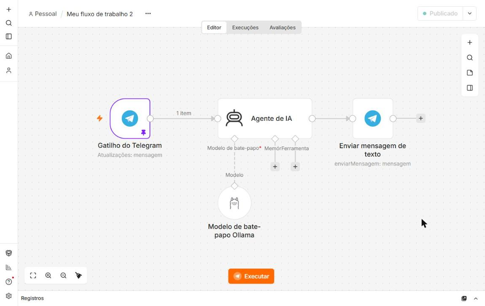

# Automações com n8n

Portfólio de fluxos de automação que criei no **n8n**, rodando em um container **Docker** na **Oracle Cloud**, com integração de **IA**.

## Fluxos

| Fluxo | Descrição | Tecnologias |
|---|---|---|
| [Telegram AI Bot com Ollama](workflows/telegram-ai-bot-ollama.json) | Chatbot no Telegram: recebe a mensagem, um agente de IA gera a resposta com um modelo local (Llama 3.2 3B via Ollama) e devolve no mesmo chat. | n8n, Telegram Bot API, AI Agent (LangChain), Ollama, Docker |

## Telegram AI Bot com Ollama



```
Telegram Trigger  →  AI Agent  →  Enviar mensagem (Telegram)
                        ↑
               Ollama Chat Model (llama3.2:3b)
```

- **Telegram Trigger** — dispara a cada nova mensagem enviada ao bot.
- **AI Agent** — usa o texto recebido como prompt.
- **Ollama Chat Model** — modelo de linguagem rodando localmente (sem custo de API e sem enviar dados para terceiros).
- **Send a text message** — responde no mesmo chat (`chat.id` da mensagem original).

## Como importar

1. No n8n, crie um novo workflow e use **⋯ → Import from File** com o arquivo `.json` desta pasta.
2. Crie suas credenciais (**Telegram API** com o token do @BotFather e **Ollama** com a URL do seu servidor) e selecione-as nos nós — os IDs no arquivo são apenas marcadores.
3. Ative o workflow.

> Os arquivos não contêm tokens nem senhas: credenciais ficam somente na instância do n8n.

---
Patrícia Freitas · em transição para tecnologia · [LinkedIn](https://www.linkedin.com/in/patricia-freitas1)
